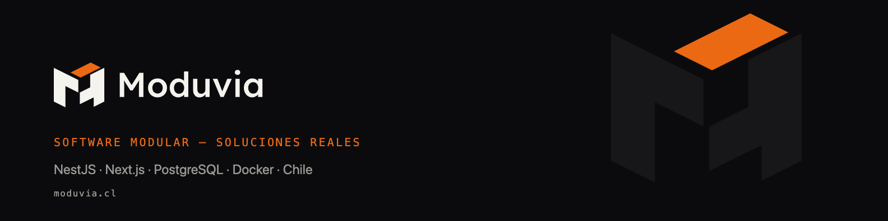

<picture>
  
</picture>

### Hola, soy Javier 👋

Co-fundador de [**Moduvia**](https://www.moduvia.cl), una empresa chilena de software modular. Construimos el software a medida que una empresa necesita para escalar: ERP, backoffice y plataformas internas.

> Las piezas son módulos. Lo que sostienen arriba es tu operación.

#### En qué trabajo
- 🧩 **Sistemas a medida** con NestJS, Next.js y PostgreSQL
- 🤖 **Automatización con IA** de procesos operativos
- 💳 **Integraciones de pago** con pasarelas locales
- 🏗️ **Arquitectura y migraciones**, incluida infraestructura propia con Docker

#### Stack

#### Cómo trabajamos
`Discovery` → `Arquitectura` → `Desarrollo iterativo` → `Mantención`

#### Contacto
[moduvia.cl](https://www.moduvia.cl) · [contacto@moduvia.cl](mailto:contacto@moduvia.cl)

*Software modular. Soluciones reales.*
